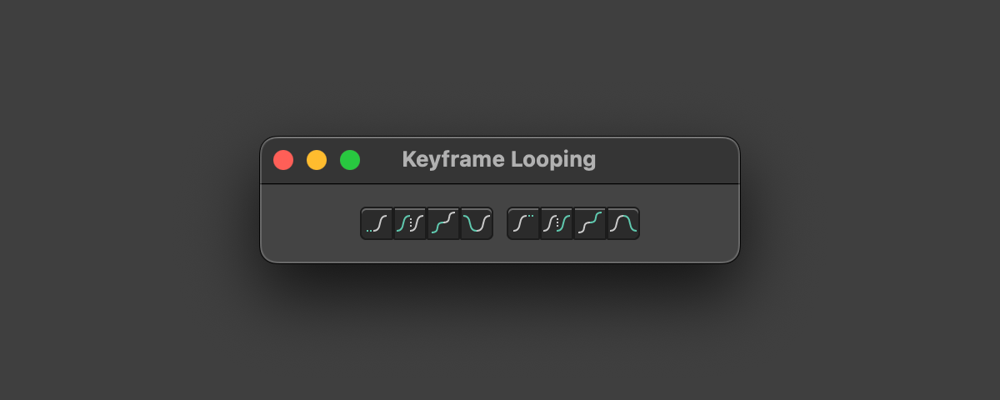

# Keyframe Looping

> Version 1.1.1
> Supports Cavalry 2.6.0 and later.
> **[Free Download](https://github.com/yevgenymakarov/yevgenymakarov.github.io/releases/download/v1/Keyframe.Looping.zip "Download the zip file")**
{: .py-3 .bg-gray .rounded-2 }

A toolbar to quickly set looping on an animation curve.

## User Manual

**Loop After**

None, Looping, Looping with Offset, Oscillate.

**Loop Before**

None, Looping, Looping with Offset, Oscillate.



## Whay's New

Shortcut scripts, for use with hotkeys.

## See Also

- [More Cavalry scripts...](../scripts.md)
